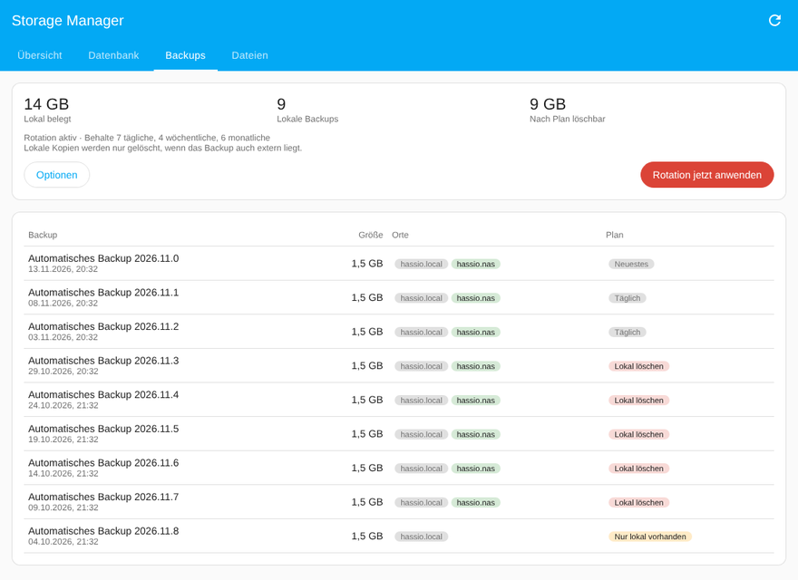

# Storage Manager for Home Assistant

> *Generated by [aurora@aurora-smart-home (ha-integration-dev skill)](https://github.com/tonylofgren/aurora-smart-home)*

[](https://github.com/hacs/integration)
[](https://github.com/johnnyh1975/ha_storage-manager/releases)

Storage Manager shows what uses the disk of your Home Assistant installation and helps you free space without guesswork. It adds a sidebar panel, sensors, repair issues and actions. Nothing is deleted without your confirmation.


## What this does

**Diagnose**
- Disk usage with a breakdown by Home Assistant, add-on data (per add-on), backups, media, share and system. The breakdown comes from the Supervisor, so it is only available on Home Assistant OS and Supervised installations.
- Growth forecast: a trend over the last 7 days, shown as "full in X days".
- Database analysis in **bytes, not rows**. Each entity's size is estimated from its state rows, its attribute payload and its long-term statistics. The estimate is calibrated with the real table sizes (SQLite `dbstat`, MariaDB `information_schema`, PostgreSQL `pg_total_relation_size`).
- Detection of history and statistics left behind by deleted entities.
- Scan of the configuration folder for known space hogs: ESPHome build cache, TTS cache, rotated logs, corrupt database copies, Zigbee2MQTT logs and crash dumps. It also lists large unknown files, which are never deleted.

**Reclaim**
- **Per-entity retention.** Home Assistant only has a global `purge_keep_days`. Storage Manager adds the tiers *7 days*, *3 days*, *1 day* and *last hour only* per entity, enforced with `recorder.purge_entities` without a restart.
- **Don't record.** This writes a real recorder exclude through a package file, so the data is never written, which reduces wear on SD cards. It needs one restart.
- **Backup rotation** of *local* copies on a daily, weekly and monthly schedule. By default a local copy is only deleted when the same backup also exists in another location (NAS, cloud).
- One-click cleanups with a preview: caches, orphaned history and statistics, database repack, and unused Docker images (via the Supervisor repair).

**Stay ahead**
- Sensors: free space, % used, days until full, growth per day, database size, local backups, reclaimable and freed in total.
- Repair issues for low space and for a disk that will be full soon. Each has a fix flow that runs the safe cleanup.
- A history of every cleanup with the space it freed.

| Database | Backups | Mobile |
|---|---|---|
|  |  |  |

## Installation

### HACS (recommended)
1. In HACS, open the menu → **Custom repositories**.
2. Add `https://github.com/johnnyh1975/ha_storage-manager` with the category **Integration**.
3. Install **Storage Manager** and restart Home Assistant.
4. Go to **Settings → Devices & services → Add integration → Storage Manager**.

### Manual
Copy `custom_components/storage_manager` into your `config/custom_components/` folder, restart Home Assistant, then add the integration.

Requirements: Home Assistant 2026.10 or newer (that is the version it is tested on). The panel is visible to administrators only.

## Configuration

All options are under **Settings → Devices & services → Storage Manager → Configure**:

| Option | Default | Meaning |
|---|---|---|
| Warn below free space | 15 % | Creates a repair issue below this value |
| Warn when full within | 14 days | Repair issue based on the growth trend |
| Rotate local backups | off | Includes the backup rotation in the safe cleanup |
| Keep daily / weekly / monthly | 7 / 4 / 6 | Rotation schedule for local copies |
| Only delete if stored elsewhere | on | Never deletes the only copy of a backup |
| Update interval | 15 min | Disk and backup polling |
| Daily database analysis at | 03:05 | The analysis also runs on demand |

### Recorder exclusions ("Don't record")
Home Assistant reads recorder filters only from YAML and only at startup. Storage Manager writes `packages/storage_manager.yaml` with an `exclude.entities` list. Packages merge lists, so your own `recorder:` block stays untouched and keeps working.

If you don't use packages yet, a repair issue offers to append the following to `configuration.yaml` (a backup copy is written first):

```yaml
homeassistant:
  packages: !include_dir_named packages
```

If your `configuration.yaml` already has a `homeassistant:` section, add the `packages:` line there yourself.

### Actions
- `storage_manager.cleanup`: `targets` (backups, files, orphans, statistics, repack, docker) and `dry_run`. Returns what was or would be freed.
- `storage_manager.analyze_database`: returns the 20 largest entities.
- `storage_manager.set_retention`: `entity_id`, `tier` (`default`, `7`, `3`, `1`, `drop`) and `purge_now`.

## How it works / limits

- **Retention tiers can only shorten the global retention.** The nightly purge of Home Assistant still removes everything older than `purge_keep_days`. Long-term statistics (hourly mean/min/max) are kept by Home Assistant independently of these tiers.
- *Last hour only* still writes the data and removes it hourly. Use *Don't record* to avoid the writes.
- Purging frees space inside the database file. The file itself only shrinks after a repack, which Home Assistant does automatically every second Sunday. A repack needs about as much free space as the database size, and Storage Manager refuses to start one without it.
- Only paths from a fixed catalogue inside the config folder can be deleted. Symlinks are never followed. Rotated logs and corrupt database copies are marked *review* and are not part of the safe cleanup.
- Coming from **GUI Recorder**: the panel offers to import its exclusions. Afterwards remove `recorder: !include gui_recorder.yaml` and uninstall GUI Recorder.
- Home Assistant has started on native per-entity recorder options (`recorder/entity_options`, read-only so far). Storage Manager will switch to that API once it can be written.

## Troubleshooting

- **The panel shows no breakdown by area.** The Supervisor provides it, so it is not available on Container or Core installations.
- **"Don't record" has no effect.** Check for the restart repair issue, and check that `packages/storage_manager.yaml` exists and is inside a folder included as packages. If your recorder uses an `include:` list, an exclude only matters for entities that the include list matches.
- **The analysis takes long.** On large MariaDB or PostgreSQL databases the analysis scans the `states` table once. It runs in the recorder's database executor and does not block Home Assistant.
- Debug logging:
  ```yaml
  logger:
    logs:
      custom_components.storage_manager: debug
  ```
- Diagnostics: **Settings → Devices & services → Storage Manager → ⋮ → Download diagnostics**.

## Recovery

- To undo exclusions, set the entities back to *Default* in the panel and restart. Alternatively, delete `packages/storage_manager.yaml` and restart.
- Removing the integration deletes the package file and the stored settings. A restart is needed so the recorder records the excluded entities again.
- Purged history and deleted backups or files cannot be restored. Every cleanup shows a preview first.

## Development

```bash
# Python tests (Home Assistant test harness, Python 3.14)
pip install pytest-homeassistant-custom-component
pytest

# Panel (Lit, bundled with esbuild)
cd frontend && npm install && npm run build
```

The built panel `custom_components/storage_manager/frontend/storage-manager-panel.js` is committed, so HACS installs work without a build step.

## License

MIT
