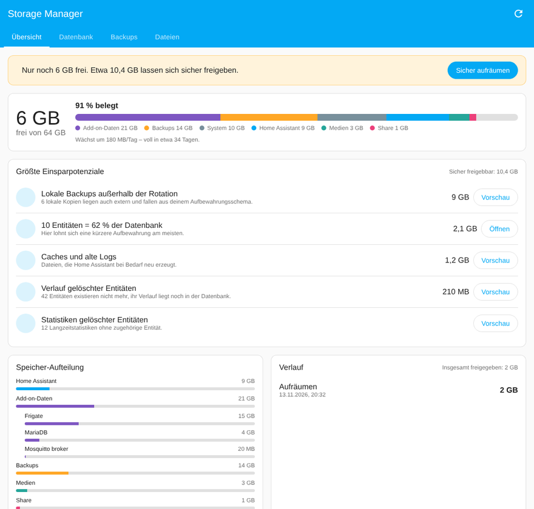
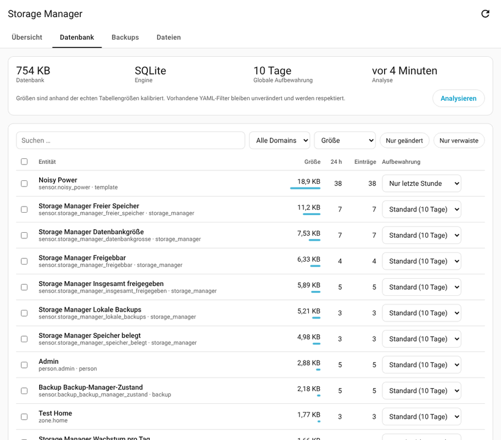
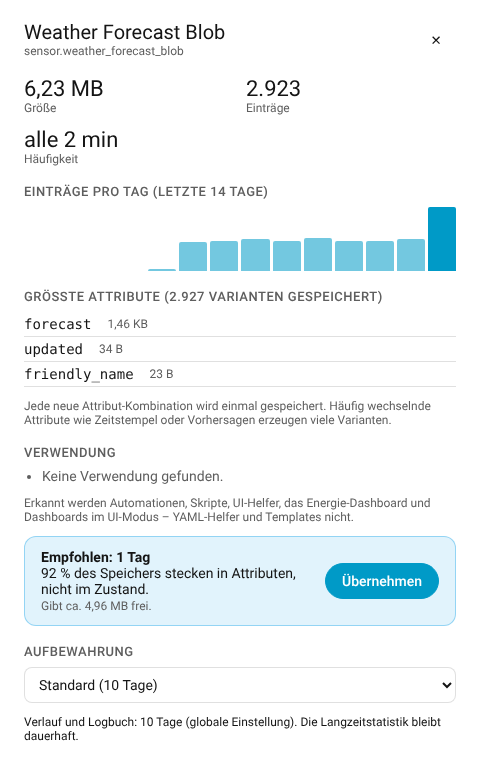
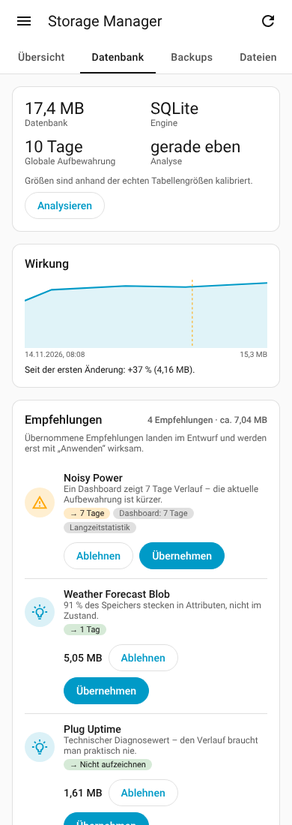
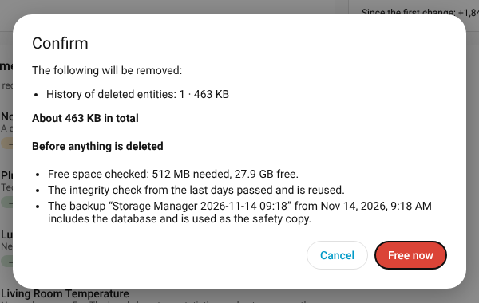
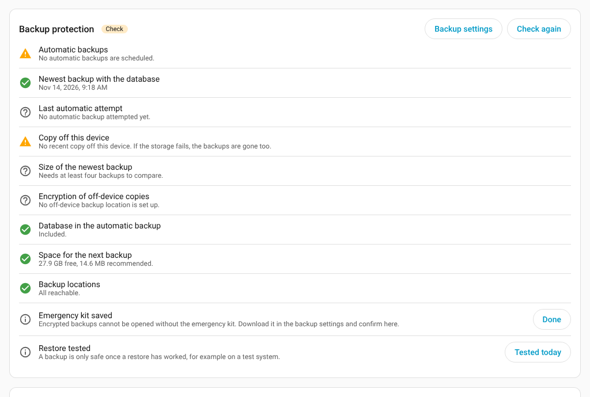
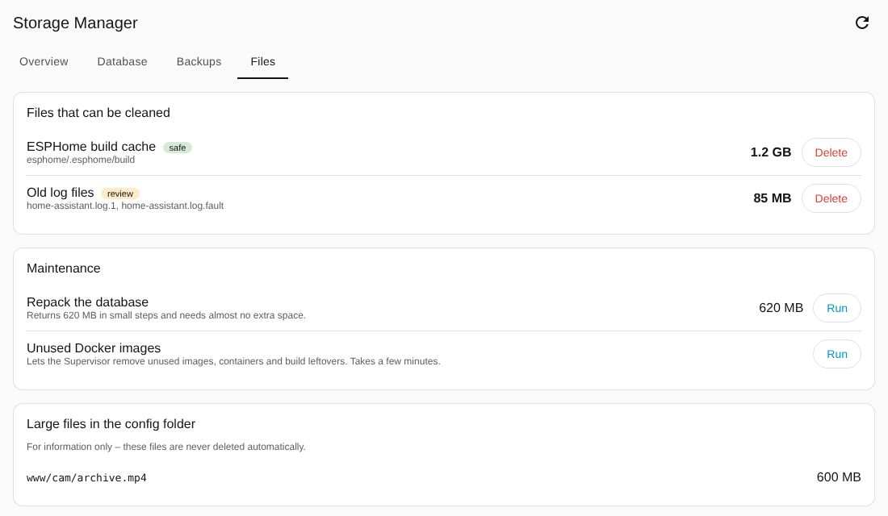

# Storage Manager for Home Assistant

> *Generated by [aurora@aurora-smart-home (ha-integration-dev skill)](https://github.com/tonylofgren/aurora-smart-home)*

[](https://my.home-assistant.io/redirect/marketplace_repository/?owner=johnnyh1975&repository=ha_storage-manager&category=integration)
[](https://github.com/johnnyh1975/ha_storage-manager/releases)
[](https://www.home-assistant.io/)
[](https://github.com/johnnyh1975/ha_storage-manager/blob/main/LICENSE)
[](https://github.com/johnnyh1975/ha_storage-manager/releases)

[](https://github.com/johnnyh1975/ha_storage-manager/actions/workflows/validate.yml)
[](https://github.com/johnnyh1975/ha_storage-manager/actions/workflows/hassfest.yml)
[](https://github.com/johnnyh1975/ha_storage-manager/actions/workflows/hacs.yml)

[](https://my.home-assistant.io/redirect/marketplace_repository/?owner=johnnyh1975&repository=ha_storage-manager&category=integration)

**See what fills the disk of your Home Assistant, and free space without guesswork.** Storage Manager measures the recorder database in bytes per entity, explains what to change and why, protects the history your dashboards and helpers need, and cleans up backups, caches and leftovers. Everything runs from a sidebar panel; nothing is deleted without a preview and your confirmation.



**Why Storage Manager?**
- **Answers instead of numbers.** The recorder only offers a global retention in YAML. Storage Manager shows which entities take the space, in bytes (not just row counts), and suggests a concrete fix for each, with the reason and the expected saving.
- **Safe by design.** Before suggesting anything it checks where an entity is used: energy dashboard, history cards, statistics helpers. Before deleting anything from the database it checks free space and integrity and makes a verified backup.
- **Per-entity retention without a restart.** Keep 7 days, 3 days, 1 day or only the last hour for single entities, on top of Home Assistant's global retention.
- **No YAML editing.** Recorder settings and exclusions are written to a package file, next to your own configuration, never into it.
- **One place for all storage.** Database, backups, add-on data, caches and logs, with a growth forecast and repair issues before the disk runs full.

---

## Contents

- [What you get](#what-you-get)
- [Feature status](#feature-status)
- [Requirements](#requirements)
- [Installation](#installation)
- [Getting started](#getting-started)
- [Configuration](#configuration)
- [How it works](#how-it-works)
- [Known limitations](#known-limitations)
- [Troubleshooting](#troubleshooting)
- [Removal and recovery](#removal-and-recovery)
- [Translations](#translations)
- [Contributing](#contributing)
- [Credits](#credits)

---

## What you get

**Diagnose**
- Disk usage by area: Home Assistant, add-on data (per add-on), backups, media, share and system. The breakdown comes from the Supervisor, so it needs Home Assistant OS or Supervised.
- Growth forecast from the last 7 days, shown as "full in X days".
- Database analysis **in bytes per entity**: state rows, attribute payload and long-term statistics, calibrated with the real table sizes (SQLite `dbstat`, MariaDB `information_schema`, PostgreSQL `pg_total_relation_size`).
- Which attributes keep changing and make an entity write new rows even when its state stays the same.
- History and statistics left behind by deleted entities.
- **Health checks** for the database (write-ahead log, growth, integrity, statistics issues) and the backups (schedule, newest backup, failed attempts, copy off this device, size, encryption, room for the next one, and whether a restore was ever tested).
- Known space hogs in the config folder: ESPHome build cache, TTS cache, rotated logs, corrupt database copies, Zigbee2MQTT logs and crash dumps. Large unknown files are listed but never deleted.

**Decide**
- **Recommendations inbox** with the reason ("technical diagnostic value", "92 % of the space is attributes", "new value every 2 s, statistics are kept") and the estimated saving. Accept, dismiss (remembered) or accept all into a draft.
- **Usage protection**: automations and scripts are noted; statistics, history_stats and filter helpers are never shortened; energy dashboard entities are never excluded; history cards set a minimum retention from their time span.
- **Rules by kind of sensor** (power, energy meters, GPS trackers, time and date, presence and distance, diagnostic values), judged per integration so that hundreds of small sensors count together. Fast sensors come with a hint how to throttle them at the source (ESPHome, Powercalc, Shelly). Each kind's rule can be changed or switched off in the database view. See [the rules and their sources](https://github.com/johnnyh1975/ha_storage-manager/blob/main/docs/sensor-rules.md).
- **Top causes first**: the entities that make up 80 % of the database, a view by integration, and the full filterable list.
- **Detail sheet** per entity: rows per day for 14 days, the largest attributes, where the entity is used and what each retention level means.
- **Effect chart**: database size after every analysis, with markers for your changes.
- **Recorder settings without YAML**: retention, commit interval, nightly purge and repack, exclude filters for domains, patterns and event types. Keys you set in your own YAML stay yours and are shown as locked.

**Reclaim**
- Per-entity retention: *7 days*, *3 days*, *1 day*, *last hour only*.
- *Don't record*: a real recorder exclusion, so the data is never written (less wear on SD cards). Needs one restart.
- Rotation of *local* backup copies on a daily, weekly and monthly schedule. By default a local copy is only deleted when the same backup also exists elsewhere (NAS, cloud).
- One-click cleanups with a preview: caches, orphaned history and statistics, outdated rows, database repack and unused Docker images.
- **Safety chain** before every deletion in the database: free space, integrity check and a verified backup with the database. A damaged database stops all deletions.
- **Repack with little free space**: in small steps, ordinary, or with the temporary copy in RAM, picked from the measured free pages.

**Stay ahead**
- Sensors: free space, % used, days until full, growth per day, database size, local backups, reclaimable and freed in total.
- Repair issues for low space and for a disk that will be full soon, each with a fix flow that runs the safe cleanup.
- A log of every cleanup with the space it freed.

| Database | Detail | Mobile |
|---|---|---|
|  |  |  |

| Before deleting | Backup protection | Files and repack |
|---|---|---|
|  |  |  |

---

## Feature status

| Feature | Status |
|---|---|
| Disk breakdown, growth forecast, sensors, repair issues | ✅ Shipped (0.1) |
| Byte-based database analysis, orphan detection, file cleanup, backup rotation | ✅ Shipped (0.1) |
| Recommendations with usage protection, detail sheet, effect chart, recorder settings | ✅ Shipped (0.2) |
| Safety chain before deleting from the database: free-space check, integrity check, verified backup, deletion log | ✅ Shipped (0.3) |
| Repack with little free space (incremental, or with the temporary copy in RAM) | ✅ Shipped (0.3) |
| Analysis in steps with progress and stop for large databases; attribute-only updates and changing attributes | ✅ Shipped (0.3) |
| Health checks for the database and the backups | ✅ Shipped (0.3) |
| Rules by kind of sensor, judged per integration; hints for throttling at the source | ✅ Shipped (0.4) |
| Rules per kind of sensor configurable; retention savings in the overview | ✅ Shipped (0.5) |
| Dashboard cards, busiest hour of the day | ⏳ Planned |
| Home Assistant's native per-entity recording option instead of the package file | ⏳ Once Home Assistant can write it ([architecture#1276](https://github.com/home-assistant/architecture/discussions/1276)) |
| Database migration SQLite → MariaDB/PostgreSQL | ❌ Not planned |

Release history: [GitHub Releases](https://github.com/johnnyh1975/ha_storage-manager/releases) · [Changelog](https://github.com/johnnyh1975/ha_storage-manager/blob/main/CHANGELOG.md)

---

## Requirements

- Home Assistant **2026.10** or newer.
- Recorder with SQLite (default), MariaDB/MySQL or PostgreSQL.
- Disk breakdown, add-on sizes and Docker cleanup need Home Assistant OS or Supervised. Everything else works on every installation type.
- The panel is visible to administrators only.

---

## Installation

### Marketplace (Home Assistant 2026.11 and newer)

[](https://my.home-assistant.io/redirect/marketplace_repository/?owner=johnnyh1975&repository=ha_storage-manager&category=integration)

1. Click the button above. Or open **Settings → Marketplace → Add from link**, paste `https://github.com/johnnyh1975/ha_storage-manager` and choose **Integration**. The first time, the Marketplace asks you to connect GitHub.
2. Select **Install**, then **Restart Home Assistant**.
3. Add the integration (next section).

### HACS (Home Assistant 2026.10)

[](https://my.home-assistant.io/redirect/hacs_repository/?owner=johnnyh1975&repository=ha_storage-manager&category=integration)

1. Click the button, or in HACS open the menu → **Custom repositories** and add `https://github.com/johnnyh1975/ha_storage-manager` as **Integration**.
2. Download **Storage Manager** and restart Home Assistant.

### Manual

Copy `custom_components/storage_manager` from the [latest release](https://github.com/johnnyh1975/ha_storage-manager/releases/latest) into `config/custom_components/` and restart Home Assistant.

---

## Getting started

[](https://my.home-assistant.io/redirect/config_flow_start/?domain=storage_manager)

1. Add the integration: click the button, or **Settings → Devices & services → Add integration → Storage Manager**.
2. Open **Storage Manager** in the sidebar. The first database analysis starts by itself and runs again every night.
3. **Overview** shows where the space goes and what can be freed safely. **Database** shows the recommendations; accept the ones you agree with and apply the draft.
4. If you choose *Don't record* and don't use packages yet, a repair issue offers to set them up (see below).

---

## Configuration

**Settings → Devices & services → Storage Manager → Configure**:

| Option | Default | Meaning |
|---|---|---|
| Warn below free space | 15 % | Creates a repair issue below this value |
| Warn when full within | 14 days | Repair issue based on the growth trend |
| Rotate local backups | off | Includes the backup rotation in the safe cleanup |
| Keep daily / weekly / monthly | 7 / 4 / 6 | Rotation schedule for local copies |
| Only delete if stored elsewhere | on | Never deletes the only copy of a backup |
| Back up before deleting from the database | on | Creates and verifies a backup with the database first; one from the last 6 hours is reused |
| Update interval | 15 min | Disk and backup polling |
| Daily database analysis at | 03:05 | The analysis also runs on demand |

### Recorder exclusions and packages

Home Assistant reads recorder filters only from YAML and only at startup. Storage Manager writes `packages/storage_manager.yaml`; packages merge lists, so your own `recorder:` block stays untouched. Without packages, a repair issue offers to append this to `configuration.yaml` (a backup copy is written first):

```yaml
homeassistant:
  packages: !include_dir_named packages
```

If your `configuration.yaml` already has a `homeassistant:` section, add the `packages:` line there yourself.

### Actions

| Action | Fields | What it does |
|---|---|---|
| `storage_manager.cleanup` | `targets`, `dry_run` | Cleans backups, files, orphans, statistics, repack, docker. Returns what was or would be freed |
| `storage_manager.analyze_database` | – | Runs the analysis and returns the 20 largest entities |
| `storage_manager.set_retention` | `entity_id`, `tier`, `purge_now` | Sets `default`, `7`, `3`, `1` or `drop` for entities |

---

## How it works

**Data updates.** Disk usage is read every 15 minutes (configurable), backups and the add-on breakdown hourly, the file scan every 6 hours. The database analysis runs nightly and on demand in the recorder's own database executor, so it does not block Home Assistant.

**Retention tiers** are enforced with `recorder.purge_entities`: hourly for *last hour only*, daily for the other tiers, right after Home Assistant's own nightly purge. They can only shorten the global retention. Long-term statistics (hourly mean/min/max) are kept by Home Assistant regardless.

**Before deleting from the database** (history of deleted entities, orphaned statistics, retention changes applied at once) Storage Manager checks the free space, runs SQLite's full integrity check (a clean result is reused for three days) and makes a backup of Home Assistant with the database, which it verifies in the backup list. The space it asks for is the room for the deletion plus the size of your last backup with the database. Purging outdated rows runs without a backup, since Home Assistant deletes them every night anyway. If any step fails, nothing is deleted. The cleanup log names the backup and the deleted entities.

**Repack.** Purging frees space inside the database file; the file shrinks only after a repack. An ordinary repack needs about twice the data that remains as free space, not twice the file. Storage Manager reads the file's free pages and picks what fits: small steps (almost no extra space, once the file is in incremental mode), an ordinary repack, or one with the temporary copy in RAM. It runs on the recorder thread, as Home Assistant's own repack does.

**Deletions** only touch paths from a fixed catalogue inside the config folder, never through symlinks. Rotated logs and corrupt database copies are marked *review* and are not part of the safe cleanup.

**Your data stays local.** Storage Manager sends nothing to third parties. It reads the recorder database, Home Assistant's backup manager (which asks your configured backup locations for their lists) and, on Home Assistant OS or Supervised, the Supervisor.

---

## Known limitations

- *Last hour only* still writes the data and removes it hourly. Use *Don't record* to avoid the writes.
- Some SQLite builds (for example on Home Assistant OS) have no `dbstat`. Sizes are then scaled to the bytes in use in the file; the split between tables stays an estimate.
- The integrity check and the repack options exist for SQLite. MariaDB and PostgreSQL use Home Assistant's own repack, and MariaDB reports table sizes only as estimates.
- The emergency kit and the restore test can't be detected; you confirm them yourself in the panel.
- Usage detection covers UI-configured helpers and storage-mode dashboards. YAML helpers, YAML dashboards and templates are not analysed; check those before shortening a history they read.
- A recorder key you already set in `configuration.yaml` or another package is never written again, because Home Assistant rejects a package with a duplicate key. It shows as locked in the panel.
- Home Assistant has started on native per-entity recorder options (`recorder/entity_options`, read-only so far). Storage Manager will switch to it once it can be written.

---

## Troubleshooting

- **No breakdown by area:** it comes from the Supervisor and is not available on Container or Core installations.
- **"Don't record" has no effect:** check for the restart repair issue, and that `packages/storage_manager.yaml` exists in a folder included as packages. With an `include:` list in your recorder, an exclude only matters for entities the include matches.
- **The analysis takes long:** on large databases it reads every table once, in steps. The panel shows the progress and can stop it; the previous result stays. Home Assistant keeps running meanwhile.
- **"Nothing deleted from the database":** one of the safety steps failed; the dialog says which. Free space first, or continue without a backup if you accept that deleted history can't be restored.
- **Coming from GUI Recorder:** the panel offers to import its exclusions. Afterwards remove `recorder: !include gui_recorder.yaml` and uninstall GUI Recorder.
- **Debug logging:**
  ```yaml
  logger:
    logs:
      custom_components.storage_manager: debug
  ```
- **Diagnostics:** Settings → Devices & services → Storage Manager → ⋮ → Download diagnostics. Please attach them to [an issue](https://github.com/johnnyh1975/ha_storage-manager/issues).

---

## Removal and recovery

- To undo exclusions, set the entities back to *Default* in the panel and restart, or delete `packages/storage_manager.yaml` and restart.
- Removing the integration (Settings → Devices & services → Storage Manager → ⋮ → Delete) deletes the package file and the stored settings. Restart so the recorder records the excluded entities again. Then remove it in the Marketplace or HACS.
- Purged history and deleted backups or files cannot be restored. Every cleanup shows a preview first.

---

## Translations

English and German, for the panel, the options, repair issues and actions. Contributions for other languages are welcome; every text lives in `strings.json`, `translations/` and `frontend/src/i18n.js`.

---

## Contributing

```bash
# Python 3.14
pip install -r requirements_test.txt
bash scripts/check_all.sh   # ruff, mypy --strict, translations, versions and links,
                            # private data, tests with 95 % coverage per module, panel build
```

The panel lives in `frontend/src` (Lit, bundled with esbuild); the built file is committed so installs need no build step. Rules for contributions are in [AGENTS.md](https://github.com/johnnyh1975/ha_storage-manager/blob/main/AGENTS.md). Releases are made by the maintainer through **Actions → Release**.

---

## Credits

- [HA Housekeeper](https://github.com/bertel2020/HA-Housekeeper) (MIT) inspired the safety chain, the attribute insights, the analysis in steps and several backup checks. The code is written for Storage Manager.
- [GUI Recorder](https://github.com/ideaalab/gui-recorder) showed that recorder exclusions belong in a UI; Storage Manager can import its settings.
- Built with the [Home Assistant developer documentation](https://developers.home-assistant.io/).

## License

[MIT](https://github.com/johnnyh1975/ha_storage-manager/blob/main/LICENSE)
